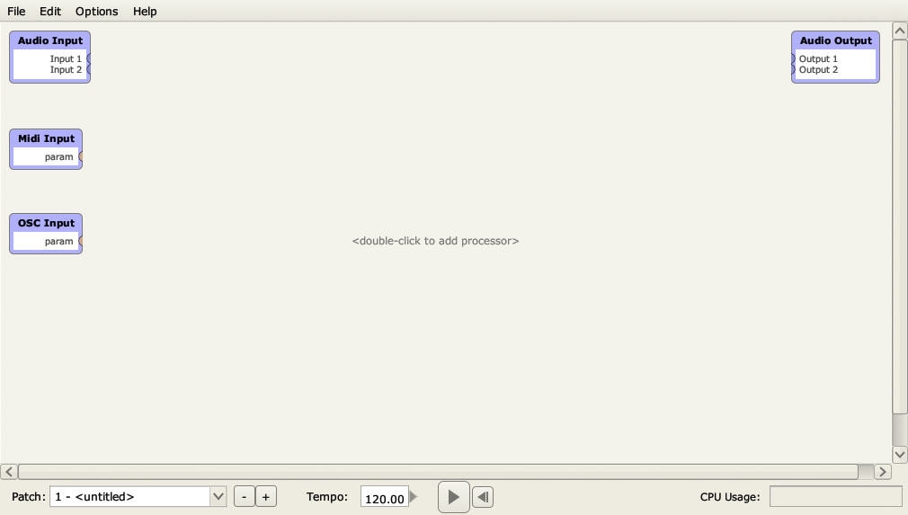

# Pedalboard Host

**A live VST2/VST3 effects host for performers, rebuilt in Rust and egui.**


[](LICENSE)

Pedalboard Host is a modern rebuild of **Pedalboard2 v2.09 (64-bit)**, the JUCE-based live effects host. It keeps the original's look, file formats and behaviour. It adds **VST3 support** and an audio path built for **low latency** with ASIO. A core intention of the project is to preserve a simple, focused UI while keeping resource use to a minimum, which is why the project is built with rust.

<p align="center">
  
</p>

---

## Table of contents

- [Features](#features)
- [Getting started](#getting-started)
- [Usage](#usage)
- [Patch and preset management](#patch-and-preset-management)
- [Built-in processors](#built-in-processors)
- [Project layout](#project-layout)
- [Design notes](#design-notes)
- [Differences from the original](#differences-from-the-original)
- [Status](#status)
- [License](#license)

---

## Features

- 🎛️ **Patch canvas**: add processors with a double-click and connect audio and parameter pins with cables.
- 🔌 **VST2 and VST3 plugins**. The plugin scanner runs each file in a separate process, so a plugin that crashes during a scan can't take the host down.
- ⚡ **Low-latency audio**:
  - **ASIO**: the host talks to the driver directly over COM and processes audio inside the driver's buffer-switch callback. Nothing is buffered on top, so latency equals the driver's buffer size.
  - **WASAPI**: used when no ASIO driver is installed. The input ring is trimmed on every callback so latency doesn't build up.
- 🎹 **MIDI**:
  - Map CCs to any plugin parameter, with latch mode and lower/upper bounds.
  - Program Change messages can switch patches.
  - MMC messages can control the transport.
- 📡 **OSC input** over UDP (default port `5678`), with optional multicast.
- 🗂️ **Patches**: several patches per `.pdl` file, next/previous switching, and an optional wrap-around from the last patch to the first. Organise patches in bulk, and import or export patches from the organiser.
- 🎚️ **Presets**: per-plugin preset bars, `.fxp` import/export, and a manager for copying, renaming, importing and removing presets. Built-in processors can save and load presets too.
- ⏱️ **Main transport**: tempo, tap tempo, play/pause and return to zero.
- 🎨 **Colour schemes**: compatible with Pedalboard2's `.colourscheme` files.
- 🧰 **Application mappings** let you assign keyboard shortcuts, MIDI CCs and OSC messages to menu, patch and transport commands.
- 🪟 **Desktop windows** let you place settings, the patch organiser and processor editors outside the main window. They hide and return with the main window.
- 🛟 **Freeze and crash reports**: a watchdog writes a note and a memory snapshot if the window stops responding for 5 s or the program crashes.
- **System tray** support keeps audio and controller mappings running while the main window is hidden. The icon returns automatically when Windows Explorer restarts.

## Getting started

### Requirements

- Windows 10/11 x64
- [Rust](https://rustup.rs/) with the **`stable-x86_64-pc-windows-gnu`** toolchain. This is pinned in `app/rust-toolchain.toml`, so `rustup` installs it automatically.
- An ASIO driver (recommended) or any WASAPI audio device

### Build

```powershell
cd app
cargo build --release
```

The executable is written to `app/target/release/pedalhost.exe`.

> [!NOTE]
> Debug builds are also compiled with optimisation (`opt-level = 2`) so the audio path stays fast during development.

### Run tests

```powershell
cd app
cargo test
```

## Usage

```text
pedalhost.exe [file.pdl] [--screenshot out.png]
```

| Option | Description |
|---|---|
| `<file.pdl>` | Open a patch file at startup |
| `--screenshot <file.png>` | Draw about 120 frames, save a screenshot of the window, then exit (used for automated checks) |
| `--scan-plugin <file>` | *Internal.* Prints a description of one plugin file as JSON. The plugin scanner uses this. |

### Quick start

1. Choose your device in **Options → Audio Settings**.
2. Scan for plugins in **Options → Plugin List**.
3. **Double-click** an empty part of the canvas to add a processor.
4. Drag from an output pin to an input pin to connect them.
5. Click **e** on a processor box to open its editor or **m** to map controls to that processor's parameters.

Settings are stored in `%APPDATA%\PedalboardHost\settings.json`, and the default patch is `default.pdl` in the same folder.

### Map a shortcut or controller

Open **Options → Application Mappings** and click **+** beside a command, such as **Patch → Next Patch** or **Main Transport → Tap Tempo**. Choose an input, then click **OK**.

| Input | How to assign it |
|---|---|
| Keyboard | Choose **Add Key Mapping** and press the shortcut. If another command uses it, confirming moves the shortcut to the new command. |
| MIDI footswitch or controller | Choose **Add MIDI CC Mapping**. Select **MIDI Learn** and operate the control, or pick its CC number. Leave **Channel** on **Any** or choose 1–16. Each matching CC message with a value of 65–127 runs the command. |
| OSC | Choose **Add Open Sound Control Mapping**. Type an address such as `/pedalboard/next` or pick one from **Received addresses**. **Parameter** counts float arguments from zero. The command runs when the selected float exceeds 0.5. |

Select MIDI devices in **Options → Audio Settings**. For OSC, enable **OSC Input** and set the UDP port in **Options → Misc Settings**. To remove one assignment, click it and choose **Remove Mapping**. **Reset to defaults** clears custom assignments and restores the original keyboard shortcuts.

Application mappings apply across patches and are saved in `%APPDATA%\PedalboardHost\AppMappings.xml`. On first use, the host imports any existing Pedalboard2 application mappings and controller assignments from older rebuild settings.

### Run from the system tray

On a fresh install, the main window opens and the tray icon appears. With the icon active, closing the main window or choosing **File → Exit** hides it while audio and MIDI/OSC controls keep running. Double-click the icon to show or hide the window. To exit the host, right-click the icon and choose **Quit**. The host prompts you to save any unsaved patch changes.

To launch with the window hidden, enable **Start in tray** under **Options → Misc Settings** with **Display tray icon** enabled.

## Patch and preset management

Use **Edit → Organise patches** to rename, copy, remove or reorder patches. The organiser also imports patches from another `.pdl` file and exports selected patches to a separate `.pdl` file. The currently playing patch stays selected when patches are reordered; importing a patch adds it to the open set without switching away from the current patch.

Open a processor's editor to use its **Presets** bar. Choose a plugin program or a saved preset from the list, type a name and use **Save** to store the current sound. **Import** loads an `.fxp` file into the current processor; it does not add that file to the saved-preset list.

Use **Edit → User Preset Management** (or **User presets...** from a processor's context menu) to manage saved presets. Select a preset to rename, copy, remove, import an `.fxp` file into that plugin's library, or export it to a file. Presets are shared with the original Pedalboard2 and are stored under `%APPDATA%\Pedalboard2\presets\`, in a folder for each plugin. Built-in processor presets use the same manager.

See the [patch and preset guide](docs/patches-and-presets.md) for the workflows and file locations in more detail. The [mechanics notes](app/MECHANICS.md) document implementation details and compatibility behavior.

## Built-in processors

| Processor | I/O | Description |
|---|---|---|
| **Level** | 2 in / 2 out | Gain dial, 0–2× (unity at the centre) |
| **Output Toggle** | 1 in / 2 out | Crossfades the signal between two outputs |
| **VU Meter** | 2 in | Stereo peak meter with an over light |
| **File Player** | 2 out | Plays WAV/AIFF files, with looping and sync to the main transport |
| **Audio Recorder** | 2 in | Records 16-bit stereo WAV at the device's sample rate |
| **Metronome** | 1 out | Sine clicks or custom accent/click samples, any time signature |
| **Looper** | 2 in / 2 out | Bar-quantised looping with auto-play, input/loop levels and seamless crossfaded joins |

## Project layout

```text
app/
├── Cargo.toml            # crate "pedalhost"
├── MECHANICS.md          # values from the original program and how the rebuild uses them
├── mechanics.json        # the same values in machine-readable form
├── vendor/webbrowser/    # patched crate (avoids linking shlwapi on the GNU toolchain)
└── src/
    ├── main.rs           # entry point, fonts, 1 ms timer precision
    ├── app.rs            # main application state and patch handling
    ├── field.rs          # plugin canvas: boxes, pins and cables
    ├── graph.rs          # processing graph and the precompiled plan
    ├── bars.rs           # menu bar and bottom transport bar
    ├── dialogs.rs        # settings, built-in and generic processor editors
    ├── editors.rs        # processor mappings, patch organiser and preset manager
    ├── app_mappings.rs   # application commands and AppMappings.xml
    ├── app_mappings/     # mapping editor and keyboard shortcut handling
    ├── subwin.rs         # desktop dialogs, prompts and drop-down lists
    ├── builtins.rs       # built-in processors (+ builtins/view.rs for their controls)
    ├── engine/           # audio engine: asio.rs, wasapi.rs
    ├── plugins/          # VST2 (vst2.rs), VST3 (vst3/), plugin editor windows
    ├── midi.rs, osc.rs   # MIDI and OSC input
    ├── pdl.rs            # .pdl patch file reading and writing
    ├── presets.rs        # per-processor preset bars and .fxp preset files
    ├── colours.rs        # colour schemes and JUCE-style colour maths
    ├── settings.rs       # settings stored as JSON
    ├── tempo.rs          # tap tempo
    ├── tray.rs           # system tray icon
    └── watchdog.rs       # freeze and crash notes
```

## Design notes

### Real-time audio

- The audio callback **never allocates, takes a lock or frees memory**.
- When a patch changes, the window thread compiles a new **plan** (processing order, buffer pool and pointer tables) and sends it to the audio thread through a lock-free queue (`rtrb`). Plans that are replaced are sent back and freed on the window thread.
- Denormals are flushed to zero.
- The audio thread applies MIDI and OSC mappings to processor parameters. The main window handles application commands. Tap Tempo uses the time each input arrived.

### Responsiveness

- Requests **1 ms timer precision** (`timeBeginPeriod(1)`) and opts out of Windows 11 power throttling. Without this, plugin GUIs that pace themselves with timers drop from about 49 fps to about 13 fps.
- VST2 editors get an idle call every 10 ms from a dedicated ticker thread.
- Vsync is off because plugin windows share the main window's thread.
- ASIO driver reset requests are debounced by 500 ms, as in the original. As an extra guard, automatic restarts are limited to 4 in any 15 seconds, so a driver that keeps asking to be reset can't hang the program.

### Fidelity to the original

The UI recreates Pedalboard2's layout, colours, fonts (Verdana) and JUCE's software colour blending. The values come from the original binary and from measurements of its screenshots. [`app/MECHANICS.md`](app/MECHANICS.md) lists each value with its source address, and marks the ones that were estimated.

Patch files (`.pdl`), plugin state (JUCE base64), mapping XML and colour schemes use the original's formats.

## Differences from the original

- **VST3 support** (the original hosts VST2 only)
- Plugins are scanned in a separate process
- The Metronome uses the device's actual sample rate instead of assuming 44.1 kHz
- The Looper keeps loops in memory (up to 120 s). Loops aren't saved with the patch.
- Boxes can be renamed by double-clicking their title
- Host dialogs and built-in and generic editors share the main window's taskbar button

See [`app/MECHANICS.md`](app/MECHANICS.md) for the full list.

## Status

🚧 **Work in progress.** While not done yet, the main workflows for the application work well, the project builds, starts and draws the main window. Its behaviour has not yet been measured against the original, and a few values in the mechanics sheet are estimates.

## License

Pedalboard Host is free software: you can redistribute it and/or modify it under the terms of the **GNU General Public License v3.0** (or any later version), as published by the Free Software Foundation. See [`LICENSE`](LICENSE) for the full text.

## Acknowledgements

- **[Pedalboard2 by Niall Moody](https://www.niallmoody.com/work/pedalboard2/)**, the original application this project recreates
- [egui / eframe](https://github.com/emilk/egui), [cpal](https://github.com/RustAudio/cpal), [midir](https://github.com/Boddlnagg/midir), [rtrb](https://github.com/mgeier/rtrb), [hound](https://github.com/ruuda/hound), [roxmltree](https://github.com/RazrFalcon/roxmltree)
